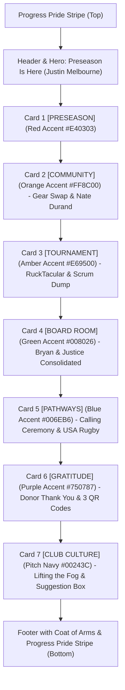

# Design Spec: The Foghorn Newsletter Pride Card Architecture & Masthead Redesign

**Date:** 2026-10-28  
**Topic:** Reimagined Pride Card Architecture & Masthead for The Foghorn (SF Fog RFC)  
**File Target:** `the_foghorn_newsletter_v3.html` & `docs/the-foghorn-2026-10-29.html`  
**Live Target:** `https://events.fogrugby.com/the-foghorn-2026-10-29.html`  

---

## 1. Problem Statement & Root Cause
In the previous draft, the layout lacked visual rhythm and created an awkward, asymmetrical card hierarchy:
1. **Mismatched Card Weight:** Nate Durand was an inline quote nestled within a multi-card event block (Event Details card + Q&A card), while Bryan Langley and Justice were each isolated inside standalone full-width sections containing only a 2-line quote with zero other content.
2. **Visual Monotony:** The alternating white and gray background bands did not provide meaningful thematic separation between articles.
3. **Masthead Sizing:** The header used the wide wordmark logo with small title text, rather than a bold, legible shield-and-title lockup.

---

## 2. Reimagined Layout & Progression
The newsletter adopts a sequential **6-Color Pride Card Architecture** (Red → Orange → Amber → Green → Blue → Purple) followed by Pitch Navy for club culture and the official footer.

---

## 3. Detailed Component Specifications

### 3.1 Masthead Redesign
- **Shield Crest:** Use the standalone SF Fog RFC shield crest (`https://events.fogrugby.com/assets/img/fog-shield.png`, 56×56px) in the top-left corner.
- **Large Masthead Typography:**
  - Title: **THE FOGHORN** (26px font-size, line-height 28px, 800 font-weight, color `#24A0F1`, letter-spacing 0.08em, Futura PT).
  - Subtitle: `San Francisco Fog RFC · Issue 25 · Oct 29, 2026` (12px, font-weight 600, color `#DCDDDE`).
- **Sub-navigation Anchors:** Quick jumps to `#preseason`, `#gear-swap`, `#rucktacular`, `#board-room`, `#pathways`, `#donations`.

### 3.2 Hero: President's Welcome & Key Dates (Dark Navy `#00243C`)
- Full letter from Justin Melbourne recognizing Pathways coaching volunteers (Alvin) and the board.
- Justin's signature card (`52×65px` avatar, 2px radius, `#24A0F1` accent).
- Quick-scan Key Dates table.

### 3.3 Card 1: `[PRESEASON]` — Pride Red Accent (`#E40303`)
- **Badge:** `PRESEASON` in `#E40303` with 1px border and 2px radius.
- **Border:** `4px solid #E40303` on the left.
- **Content:**
  - Preseason training begins Thursday Oct 29 @ 7:45pm at Crocker Amazon Park.
  - Raymond Kimbell night practice photo under the stadium lights.
  - Key practice details (boots, mouthguard, water).
  - CTA: "View Club Calendar".

### 3.4 Card 2: `[COMMUNITY]` — Pride Orange Accent (`#FF8C00`)
- **Badge:** `COMMUNITY` in `#FF8C00`.
- **Border:** `4px solid #FF8C00` on the left.
- **Content:**
  - **Mothership Gear Exchange Graphic Banner:** `https://events.fogrugby.com/assets/img/mothership-gear-exchange-banner.png`.
  - **Community Director Spotlight:** Nate Durand quote and headshot (`52×65px`).
  - **Event Details:** Nov 7, 2pm–5pm @ Mothership (3152 Mission St), drag performances, St. Anthony's clothing drive, drink specials.
  - **Gear Swap Q&A:** Station 1 (donated/free gear with rookie priority) and Station 2 (trades/sales).
  - CTAs: "View Instagram Post" and "Add to Calendar".

### 3.5 Card 3: `[TOURNAMENT]` — Pride Amber Accent (`#E69500`)
- **Badge:** `TOURNAMENT` in accessible amber (`#C27800` text, 4.5:1+ contrast on white).
- **Border:** `4px solid #E69500` on the left.
- **Content:**
  - RuckTacular San Diego 2026 banner graphic.
  - Travel deadlines (fly in Dec 3/4, matches Sat Dec 5).
  - **Scrum Dump Jockstrap Party Box:** Dark navy callout for the headline afterparty at The Brass Rail with ticket link.
  - CTAs: "Book Host Hotel" and "RuckTacular.com".

### 3.6 Card 4: `[BOARD ROOM]` — Pride Green Accent (`#008026`)
- **Badge:** `BOARD ROOM` in `#008026`.
- **Border:** `4px solid #008026` on the left.
- **Content (Consolidated Director Briefing):**
  - **Operations Dispatch (Bryan Langley):** Avatar (`52×65px`), Operations Director title, update on medkit refills, ball inventory count, and Airtag battery replacements.
  - **Inner Divider Line:** `1px solid #DCDDDE`.
  - **Fundraising Dispatch (Justice):** Avatar (`52×65px`), Fundraising Director title, thank-you to volunteers, beer pourers, and supporters at the SF Eagle Beer Bust.

### 3.7 Card 5: `[PATHWAYS]` — Pride Blue Accent (`#006EB6`)
- **Badge:** `PATHWAYS` in `#006EB6`.
- **Border:** `4px solid #006EB6` on the left.
- **Content:**
  - Welcome to the rookie class and graduation from the October course.
  - Photo 1: Rookie cohort on the pitch at Sunday's Calling Ceremony.
  - Photo 2: Closing circle huddle on the field.
  - Thank you to Alvin and drills leads.
  - **USA Rugby (CIPP) Callout:** Rugby Xplorer registration reminder before full contact play, with direct registration button.

### 3.8 Card 6: `[GRATITUDE]` — Pride Purple Accent (`#750787`)
- **Badge:** `GRATITUDE` in `#750787`.
- **Border:** `4px solid #750787` on the left.
- **Content:**
  - Heartfelt thank-you to all donors who contributed over the past month.
  - 3 QR code cards: Mazlo (501(c)(3) tax-deductible), PayPal, and Zelle side-by-side.
  - CTA: "Donate Online at FogRugby.com".

### 3.9 Card 7: `[CLUB CULTURE]` — Pitch Navy (`#00243C`)
- **Badge:** `CLUB CULTURE` in `#00243C`.
- **Border:** `4px solid #00243C` on the left.
- **Content:**
  - "Lifting the Fog" teammate recognition nomination box.
  - Anonymous Suggestion Box & Email the Board buttons.

### 3.10 Footer
- Official Coat of Arms (`64×64px`), 501(c)(3) fiscal sponsorship statement (Dancers' Group), social channels, webview and unsubscribe tokens.
- 11-band Progress Pride stripe (Bottom).

---

## 4. Accessibility & Brand Safeguards
- All tables enforce `role="presentation"`.
- Pride stripes enforce `aria-hidden="true"`.
- Sequential headings: `<h1>` (Preseason Is Here) → `<h2>` (each major card) → `<h3>` (Scrum Dump inside RuckTacular).
- All images have context-rich, accessible `alt` text.
- All buttons use strict 2px radius (`border-radius: 2px;`).
- Zero prohibited colors (no gold, no cyan, no generic slate navy).
- Practice grounds verified: Thursday at Crocker Amazon Park, Tuesday at Raymond Kimbell Playground. Zero references to Boxer Stadium.
